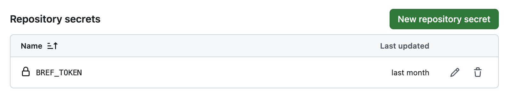

import { Steps, Cards } from 'nextra/components';
// Path relative to the copy in the `website/` folder
import { LaravelIcon } from '../../src/components/icons/LaravelIcon';
import { SymfonyIcon } from '../../src/components/icons/SymfonyIcon';

# Deployment

Bref Cloud deploys applications using Bref's `serverless.yml` file.

If you haven't gotten started with Bref, follow the guide corresponding to your framework:

<Cards num={2}>
    <Cards.Card icon={<LaravelIcon />} title="Get started with Laravel" arrow="true" href="/docs/laravel/getting-started" />
    <Cards.Card icon={<SymfonyIcon />} title="Get started with Symfony" arrow="true" href="/docs/symfony/getting-started" />
    <Cards.Card title="Get started with any PHP framework" arrow="true" href="/docs/default/getting-started" />
</Cards>

The main difference with Bref Cloud is that you don't deploy by running `serverless deploy`. Instead, you deploy by running:

```shell
bref deploy
```

(see [the Getting Started guide](./cloud-getting-started.mdx) to install the `bref` CLI)

The benefits of deploying using Bref Cloud:

- **Credentials**: You don't need to create AWS credentials or configure the `serverless` CLI, Bref Cloud handles this for you ([learn more](./cloud-security.mdx)).
- **Deployment monitoring**: Bref Cloud provides a dashboard to view deployments of all your applications across all AWS accounts, regions, and environments.
- **No need to install `serverless`**: the `bref` CLI downloads and runs the `serverless` CLI for you.
- **Better UX**: the `bref` CLI has minimal output with verbose mode that can be enabled in real time.

When you run `bref deploy`, the `bref` CLI gets temporary AWS credentials from Bref Cloud and runs `serverless deploy` with them, on your machine or in your CI. The deployment logs and status are sent to Bref Cloud.

Because `serverless deploy` runs where you run `bref deploy`, that machine needs:

- Node.js 20.19 or greater,
- the NPM dependencies of your project installed (`npm ci`), for example Serverless plugins,
- Docker, if you deploy [container images](./deploy/docker.mdx).

## Differences between `bref` and `serverless`

The `bref` CLI uses AWS credentials from AWS accounts connected in [Bref Cloud](https://bref.cloud/aws-accounts). That means that it will ignore AWS credentials configured on your machine.

The `bref` CLI also uses the [open-source fork of Serverless Framework](https://github.com/oss-serverless/osls), which is a fork of Serverless Framework v3, the last free and open-source version. This fork is maintained by Bref and ensures that the CLI is maintained and stable in the long run.

Finally, the `bref` CLI uses "**environments**" instead of "**stages**". This is just a vocabulary change. That means that you should use the `--env` option instead of the `--stage` option:

```shell
bref deploy --env production

# is equivalent to
serverless deploy --stage production
```

The default environment is `dev`.

### Options and limitations

`bref deploy` passes only these options to `serverless deploy`:

- `--param` (see [Parameters](#parameters) below),
- `--config` (or `-c`), to deploy another configuration file, for example `bref deploy --config=serverless.worker.yml`,
- `--force`.

Other `serverless deploy` options, like `--region` or `--aws-profile`, are not available, and there is no equivalent of `serverless deploy function`.

Bref Cloud reads the `service`, `provider.region` and `bref.team` fields of `serverless.yml` before `serverless` runs: these fields cannot contain variables (like `${env:AWS_REGION}` or `${param:region}`). Write their values directly.

### Supported regions

Bref Cloud can deploy to these AWS regions:

- `us-east-1`, `us-east-2`, `us-west-1`, `us-west-2`
- `ca-central-1`
- `sa-east-1`
- `eu-west-1`, `eu-west-2`, `eu-west-3`, `eu-north-1`, `eu-central-1`
- `ap-south-1`, `ap-southeast-1`, `ap-southeast-2`, `ap-northeast-1`, `ap-northeast-2`, `ap-northeast-3`

Deploying to another region fails with the error "The AWS region '…' is not supported by Bref Cloud yet".

### Parameters

To set [Serverless Framework parameters](https://www.serverless.com/framework/docs/guides/parameters) (`${param:...}` variables in `serverless.yml`) when deploying, use the `--param` option, like with `serverless deploy`. It can be repeated:

```shell
bref deploy --param="domain=example.com" --param="queue=orders"
```

## Deploying with Bref Cloud

To deploy an application using Bref Cloud, you need to add your Bref Cloud team to the `serverless.yml` file:

```yaml
service: my-app
provider:
    name: aws
    # ...

# Add these lines:
bref:
    team: my-bref-cloud-team
```

`bref.team` is the slug of your Bref Cloud team, not its display name. Run `bref teams` to list the slugs of your teams. The `--team` option overrides `bref.team`, for example `bref deploy --team=my-other-team`.

Then, you can deploy using the `bref` CLI:

```shell
bref deploy

# or for a specific environment
bref deploy --env production
```

### Several AWS accounts

A team can connect several AWS accounts to Bref Cloud, for example to deploy production in a separate account. In that case, the first `bref deploy` of a new environment asks which AWS account to deploy it to, and the environment keeps that account for the next deployments. Since CI cannot answer that question, deploy each new environment once from your terminal.

## Deployment history

Bref Cloud keeps the history of the deployments of every environment, with their logs. You can see it in the dashboard, or from the terminal:

```shell
# The latest deployments of an environment
bref deployments --env=production
# The status, git commit, author and error of the latest deployment
bref deployments:show --env=production
# The logs of the latest deployment, for example to find why it failed
bref deployments:logs --env=production

# A specific deployment, by the ID that `bref deployments` shows
bref deployments:show 42
bref deployments:logs 42
```

When given a deployment ID, these commands work from any directory. Otherwise, they need the project's configuration file, or the `--app` and `--team` options. Add `--json` for machine-readable output.

## Deploying from GitHub Actions

You can also deploy your application using GitHub Actions.

First, make sure you have set up the `bref.team` option in `serverless.yml` as shown in the section above.

Then, create a `.github/workflows/deploy.yml` workflow. Here is an example workflow you can use as a starting point:

```yaml
name: Deploy

on:
    push:
        branches: [ main ]

jobs:
    deploy:
        runs-on: ubuntu-latest
        timeout-minutes: 15
        concurrency: deploy-prod # Avoid deploying concurrently
        environment:
            name: prod
            # Optionally set a URL for the environment
            # url: https://example.com
        steps:
            -   uses: actions/checkout@v7

            -   uses: actions/setup-node@v7
                with:
                    node-version: '24'

            -   name: Cache NPM dependencies
                uses: actions/cache@v6
                with:
                    path: ~/.npm # npm cache files are stored in `~/.npm`
                    key: ${{ runner.OS }}-node-${{ hashFiles('**/package-lock.json') }}
                    restore-keys: |
                        ${{ runner.OS }}-node-

            # You can remove this step if you don't have a `package.json` file
            -   run: npm ci

            -   name: Setup PHP
                uses: shivammathur/setup-php@v2
                with:
                    php-version: '8.4'
                    coverage: none
                    # Install the Bref CLI as a global tool
                    tools: bref/cli

            -   uses: ramsey/composer-install@v4
                with:
                    composer-options: '--optimize-autoloader --no-dev'

            # You may need to build your frontend application here
            # -   run: npm run build

            -   run: bref deploy --env=prod
                env:
                    BREF_TOKEN: ${{ secrets.BREF_TOKEN }}
```

> [!TIP]
>
> Depending on your framework, you may need to add extra steps to build your application. For example with Laravel or Symfony you may want to build assets before deploying.

Finally, you need to add the `BREF_TOKEN` secret to your repository:

- Create a bot in Bref Cloud: open the [Bref Cloud dashboard](https://bref.cloud), go to "Users", and click "Add a new bot" in the "Bots" section (only team admins can create bots). Copy the token that is displayed.
- Go to your repository on GitHub
- Click on "Settings" > "Secrets and variables" > "Actions" > "New repository secret"
- Set the name to `BREF_TOKEN` and the value to the token you received after creating the bot token



Bots have the "Write" role: anyone with the token can deploy the team's applications and run commands on them. If the token leaks, delete the bot in Bref Cloud.

That's it! Your application will be deployed automatically when you push to the main branch. On the first deployment, the application will appear in the Bref Cloud dashboard.
