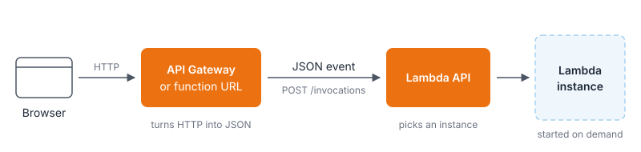
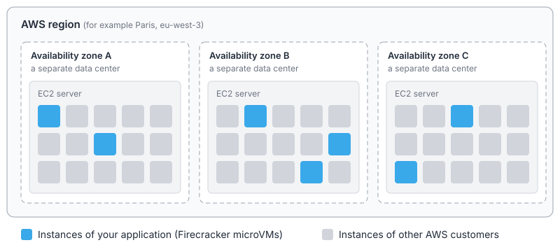
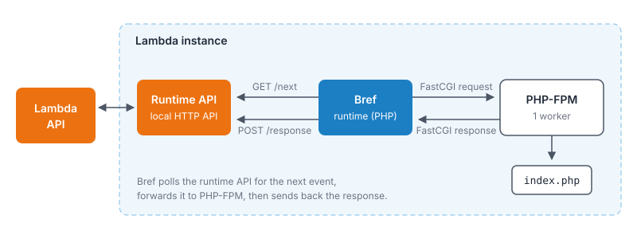
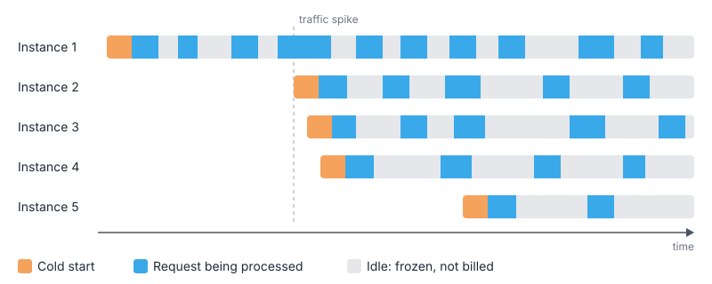
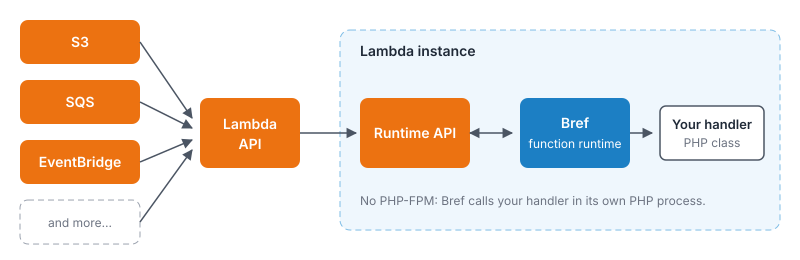

# How Bref and AWS Lambda work

Bref runs PHP on AWS Lambda. This video explains in detail how it works.

Note that understanding the low-level details is not necessary to use Bref. This video, and this page, are for those who are curious about how Bref works under the hood.

<iframe className="mt-4 w-full aspect-video" src="https://www.youtube.com/embed/r8fgR0lTV-k?si=x6qiscnX-lEo-VOQ&amp;start=399" title="YouTube video player" frameborder="0" allow="accelerometer; autoplay; clipboard-write; encrypted-media; gyroscope; picture-in-picture; web-share; fullscreen" referrerpolicy="strict-origin-when-cross-origin" allowfullscreen></iframe>

The rest of this page is a written version of the talk, updated where things have changed since it was recorded.

## Nothing runs after a deployment

When we deploy an application to AWS Lambda, nothing starts. There is no server or container waiting for requests: Lambda starts *instances* of our application on demand, when there is work to do.

The only way to run code on Lambda is to *invoke* it through the [AWS Lambda API](https://docs.aws.amazon.com/lambda/latest/api/API_Invoke.html). This is an authenticated AWS API, like the Stripe or GitHub APIs: we send a `POST` request with AWS credentials, and the data to pass to our code is a JSON payload called an *event*.

That's not how websites work, so for HTTP applications we put [API Gateway](https://aws.amazon.com/api-gateway/) in front of Lambda. API Gateway plays the role Apache or Nginx usually play: it receives HTTP requests, turns them into JSON events, and invokes Lambda.



Here is a simplified example of the event Lambda receives for an HTTP request:

```json
{
    "rawPath": "/my/path",
    "rawQueryString": "param1=foo&param2=bar",
    "headers": {
        "x-my-header": "value"
    },
    "requestContext": {
        "http": {
            "method": "GET"
        }
    },
    "body": "Hello from Lambda"
}
```

This format is specific to AWS. Code written for Lambda in Python or JavaScript usually deals with it directly. With Bref, PHP applications never see it: Bref turns it back into a regular HTTP request, as we will see below.

## Where the code runs

When deploying to AWS, we pick a *region*, for example Paris (`eu-west-3`) or Ireland (`eu-west-1`). A region is made of multiple *availability zones* (usually three or more), which are physically separate data centers. If one data center goes down (fire, flood, network outage), the others keep running.

With a server, we choose which data center it runs in. With Lambda, we deploy to the region and Lambda runs our application across all its availability zones.

Serverless still runs on servers, we just don't manage them. Lambda runs on [EC2](https://aws.amazon.com/ec2/) servers operated by AWS. Each server hosts instances from many different AWS customers, so each instance is isolated in a [Firecracker](https://firecracker-microvm.github.io/) *microVM*.



Firecracker is an open-source technology created by AWS to get the best of virtual machines and containers:

- the strong isolation of virtual machines (it is based on KVM virtualization),
- the fast startup and low overhead of containers.

It is also used to run AWS Fargate, and by other hosting providers like [Fly.io](https://fly.io/).

In a way, Lambda is a giant shared hosting platform, with modern isolation, security and scalability.

## Starting a new instance

When a request comes in and no instance is available to handle it, Lambda starts a new instance:

1. It starts a microVM, which runs a Linux environment.
2. It mounts the runtime in `/opt`. Lambda does not support PHP natively, so the PHP runtime is provided by Bref as a [Lambda layer](./runtimes.mdx#lambda-layers-or-docker-images).
3. It mounts our application code. The code is deployed as a zip archive, or as a container image. Even with container images, Lambda does not run Docker: the image is only used to ship our files and configuration, which are mounted the same way.
4. It starts the Lambda *runtime API*: a small HTTP API, running inside the instance, that the runtime uses to retrieve events and send back responses.
5. It runs the `/opt/bootstrap` executable, which starts the runtime.

With Bref, `/opt/bootstrap` is [a shell script](https://github.com/brefphp/aws-lambda-layers/blob/main/src/bootstrap.sh) that starts PHP:

```sh filename="/opt/bootstrap"
#!/bin/sh

# Fail on error
set -e

while true
do
    # We redirect stderr to stdout so that everything
    # written on the output ends up in Cloudwatch automatically
    php "/opt/bref/bootstrap.php" 2>&1
done
```

The loop restarts PHP if it ever crashes. [`bootstrap.php`](https://github.com/brefphp/aws-lambda-layers/blob/main/src/bootstrap.php) then loads the Composer autoloader of our application (the `bref/bref` package is installed in our project) and runs the Bref runtime, for example `Bref\FpmRuntime\Main` for web applications:

```php filename="/opt/bref/bootstrap.php (simplified)"
$appRoot = getenv('LAMBDA_TASK_ROOT');

require $appRoot . '/vendor/autoload.php';

// The runtime is chosen via the `BREF_RUNTIME` environment variable
// For example: `Bref\FpmRuntime\Main` for HTTP applications
$runtimeClass = /* ... */;

$runtimeClass::run();
```

The Bref runtime then connects to the runtime API (over HTTP, on localhost) to fetch the next event to process.

Using HTTP between processes of the same machine may sound surprising. It is the lowest common denominator across all programming languages: every language can make HTTP requests, but running an HTTP server is much harder in some languages (shell scripts for example). And since it all happens on localhost, it is fast.

All of this is what we call a *cold start*. It only happens when a new instance starts: we'll get back to that below.

## Running PHP-FPM

For HTTP applications, the Bref runtime starts [PHP-FPM](https://www.php.net/manual/en/install.fpm.php), the same program that runs PHP behind Nginx or Apache on a traditional server.

For each event, Bref turns the JSON event into a [FastCGI](https://en.wikipedia.org/wiki/FastCGI) request, sends it to PHP-FPM, and turns the response back into the format Lambda expects.



Bref is basically doing the job of Nginx or Apache. That means our code runs exactly like on a server: `$_GET`, `$_POST`, `$_SERVER`, headers, cookies and sessions work as usual, and so do frameworks like Laravel and Symfony.

Translating requests over and over may sound inefficient, but it works well. A request goes through a few milliseconds of network latency to reach the instance, like with any load balancer or CDN in front of a server. Inside the instance, Bref and the Lambda runtime add less than a millisecond.

Learn more about this runtime in [PHP-FPM runtime](./runtimes/fpm-runtime.mdx).

## One request at a time

Here is how instances handle requests over time. Each gray bar is an instance, each blue block is a request being processed:



On Lambda, **an instance handles only one request at a time**. There is no concurrency inside an instance. If 10 requests arrive at the same time, Lambda runs them in 10 instances, and starts new instances if needed.

Scaling is simple: when a request comes in, Lambda sends it to an available instance. If none is available, Lambda starts a new one. AWS takes care of balancing the load between instances, across all availability zones.

This may sound inefficient, but it gives an interesting guarantee: whether we have one instance or a thousand, our code always runs in the same conditions. More traffic does not mean CPU or memory pressure, and we never have to think about concurrent requests competing for resources inside an instance.

It is also exactly how PHP-FPM works: each PHP-FPM worker process handles one request at a time. That is why PHP is a great fit for Lambda: our code runs on Lambda like it runs on a server, while other languages often need to be written differently for Lambda. Bref configures PHP-FPM with a single worker for the same reason.

Note that everything else still has to scale: if 1,000 instances connect to a database that cannot handle the load, the database will be the bottleneck.

### Between requests

Between two requests, the instance stays in memory, but it is *frozen*: no code runs, and we don't pay for it. Lambda is event-driven, nothing can run in the background between events.

Since the instance stays alive, anything that is in memory or on disk is kept between requests: the OPcache, files written in `/tmp`, and so on.

After some time without traffic, Lambda shuts down idle instances. Lambda also recycles instances every few hours, even when they receive traffic continuously. In other words, instances are disposable: never rely on an instance staying alive.

### Scaling limits

Lambda can start 1,000 new instances every 10 seconds for each function. The total number of instances is limited per AWS account and region: 1,000 by default, and this can be increased to tens of thousands.

New AWS accounts start with a reduced quota that AWS raises automatically based on usage. You can also request an increase in the [Service Quotas console](https://console.aws.amazon.com/servicequotas/home/services/lambda/quotas).

When the limit is reached, additional requests are throttled: they fail with an error until instances become available. Read more about [Lambda's scaling behavior](https://docs.aws.amazon.com/lambda/latest/dg/scaling-behavior.html).

## Cold starts

Starting a new instance takes time: this is the *cold start*. A request that triggers a cold start is slower, it does not fail. Bref's runtimes add about 250ms, the rest depends on the size of the application. Very large applications can take a second or more.

All the following requests handled by that instance are as fast as on a server.

In practice, cold starts are rarer than one might think: on applications with regular traffic, about 0.2% of requests are cold starts. Lambda reuses existing instances as much as possible, and it occasionally starts instances ahead of traffic.

Cold starts matter if your application cannot tolerate occasional slow requests (real-time applications for example). They can also add up when synchronous calls chain cold starts, for example when a microservice calls another microservice that calls a third one.

In exchange, the application does not slow down when traffic increases. Read more about [cold starts and how to reduce them](./environment/cold-starts.mdx).

## Reliability

Since Lambda runs instances across all availability zones of a region, we get redundancy without setting it up. If a data center has an outage, Lambda starts new instances in the other ones. If an instance crashes, Lambda replaces it: the requests it was handling fail, but the application stays up.

## Costs

Looking at the timeline above, we pay for the blue blocks, not for the gray bars: Lambda charges per request and per millisecond of execution, cold starts included. Idle instances are free, whether there is one or a thousand.

Read more in [Serverless costs](./serverless-costs.mdx).

## Beyond HTTP: event-driven functions

Lambda can do more than run HTTP applications. AWS services can invoke our code directly:

- [S3](./use-cases/s3.mdx) (file storage) can run our code when a file is uploaded, without a watcher process.
- [SQS](./use-cases/sqs.mdx) (queues) can run our code to process messages in the queue, without a worker process.
- [EventBridge](./use-cases/eventbridge.mdx) (event bus) can run our code when another application publishes an event.

For these, Bref provides the [*function* runtime](./runtimes/function.mdx). It works like the FPM runtime, without PHP-FPM: Bref loads our handler and calls it directly in its own PHP process.



A handler is a PHP class (or a PHP file). Bref provides base classes that turn events into typed objects, for example for S3:

```php
use Bref\Context\Context;
use Bref\Event\S3\S3Event;
use Bref\Event\S3\S3Handler;

class MyHandler extends S3Handler
{
    public function handleS3(S3Event $event, Context $context): void
    {
        $bucketName = $event->getRecords()[0]->getBucket()->getName();
        $fileName = $event->getRecords()[0]->getObject()->getKey();

        // do something with the file
    }
}
```

Handlers run inside our application: with Laravel and Symfony, they are created by the framework's container, and can use models, services, dependency injection, etc.

We don't always need to write handlers: Bref integrates with [Laravel Queues](./laravel/queues.mdx) and [Symfony Messenger](./symfony/messenger.mdx). Jobs are dispatched and processed like on a server, and Bref invokes the framework for each SQS message.

## Keeping the application in memory

By default, PHP boots the application from scratch on every request, like on any PHP server. Like with [Laravel Octane](./laravel/octane.mdx) or [Symfony's runtime](./symfony/keep-alive.mdx) on a server, Bref can keep the application in memory between requests to skip that boot time, which can improve performance significantly.

This does not change the execution model: an instance still handles one request at a time, it is still frozen between requests, and we still pay only while requests are processed.

## Learn more

- [Serverless-specific constraints](./index.mdx#serverless-specific-constraints) (execution time, upload size, read-only filesystem…)
- [Cold starts](./environment/cold-starts.mdx)
- [Serverless costs](./serverless-costs.mdx)
- [Case studies](./case-studies.mdx)
