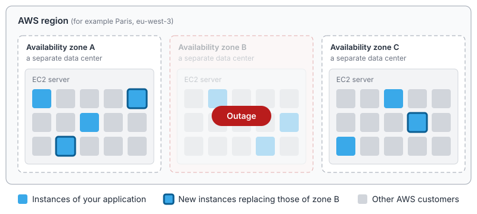

# How Bref and AWS Lambda work

Bref runs PHP on AWS Lambda. This video explains in detail how it works.

Note that understanding the low-level details is not necessary to use Bref. This video, and this page, are for those who are curious about how Bref works under the hood.

<iframe className="mt-4 w-full aspect-video" src="https://www.youtube.com/embed/r8fgR0lTV-k?si=x6qiscnX-lEo-VOQ&amp;start=399" title="YouTube video player" frameborder="0" allow="accelerometer; autoplay; clipboard-write; encrypted-media; gyroscope; picture-in-picture; web-share; fullscreen" referrerpolicy="strict-origin-when-cross-origin" allowfullscreen></iframe>

The rest of this page covers the content of the talk in writing, updated where things have changed since it was recorded.

## Lambda invocations

Deploying an application to AWS Lambda does not start anything. Lambda starts *instances* of the application on demand, when there is work to do.

Code on Lambda runs when it is *invoked* through the [AWS Lambda API](https://docs.aws.amazon.com/lambda/latest/api/API_Invoke.html). The data passed to the code is a JSON payload called an *event*. This API is called by AWS services, like API Gateway below: applications don't call it themselves.

## HTTP requests

When deploying an HTTP application, Bref sets up [API Gateway](https://aws.amazon.com/api-gateway/) in front of Lambda automatically. API Gateway receives HTTP requests, turns them into JSON events, and invokes Lambda.


Here is a simplified example of the event Lambda receives for an HTTP request:

```json
{
    "rawPath": "/my/path",
    "rawQueryString": "param1=foo&param2=bar",
    "headers": {
        "x-my-header": "value"
    },
    "requestContext": {
        "http": {
            "method": "GET"
        }
    },
    "body": "Hello from Lambda"
}
```

This format is specific to AWS. With Bref, PHP applications don't see it: Bref turns it back into a regular HTTP request (see [PHP-FPM runtime](#php-fpm-runtime) below).

## Infrastructure

An application is deployed to an AWS *region*, for example Paris (`eu-west-3`) or Ireland (`eu-west-1`). A region is made of multiple *availability zones* (usually three or more), which are physically separate data centers.

Lambda runs on [EC2](https://aws.amazon.com/ec2/) servers operated by AWS. Each server hosts instances of many AWS customers, and each instance is isolated in a [Firecracker](https://firecracker-microvm.github.io/) *microVM*.


Firecracker is an open-source virtualization technology created by AWS. It provides the isolation of virtual machines (it is based on KVM) with the fast startup and low overhead of containers. It is also used by AWS Fargate.

### Resilience

Lambda runs instances across all availability zones of the region. If a data center has an outage, Lambda starts new instances in the other ones.



If an instance crashes, Lambda replaces it: the requests it was handling fail, but the application stays up.

## Instance startup

When a request comes in and no instance is available to handle it, Lambda starts a new instance:

1. It starts a microVM, which runs a Linux environment.
2. It mounts the runtime in `/opt`. Lambda does not support PHP natively: Bref provides the PHP runtime as a [Lambda layer](./runtimes.mdx#lambda-layers-or-docker-images), and adds it to the application when deploying.
3. It mounts the application code, deployed as a zip archive (the default) or as a container image. Lambda does not run Docker: a container image is only used to ship the files and configuration, which are mounted the same way.
4. It starts the Lambda *runtime API*: an HTTP API, running inside the instance, that the runtime calls to retrieve events and send back responses.
5. It runs the `/opt/bootstrap` executable, which starts the runtime.

With Bref, `/opt/bootstrap` is [a shell script](https://github.com/brefphp/aws-lambda-layers/blob/main/src/bootstrap.sh) that starts PHP:

```sh filename="/opt/bootstrap"
#!/bin/sh

# Fail on error
set -e

while true
do
    # We redirect stderr to stdout so that everything
    # written on the output ends up in Cloudwatch automatically
    php "/opt/bref/bootstrap.php" 2>&1
done
```

The loop restarts PHP if it crashes. [`bootstrap.php`](https://github.com/brefphp/aws-lambda-layers/blob/main/src/bootstrap.php) loads the Composer autoloader of the application (where the `bref/bref` package is installed) and runs the Bref runtime:

```php filename="/opt/bref/bootstrap.php (simplified)"
$appRoot = getenv('LAMBDA_TASK_ROOT');

require $appRoot . '/vendor/autoload.php';

// The runtime is chosen via the `BREF_RUNTIME` environment variable
// For example: `Bref\FpmRuntime\Main` for HTTP applications
$runtimeClass = /* ... */;

$runtimeClass::run();
```

The Bref runtime then calls the runtime API (over HTTP, on localhost) to fetch the next event to process. AWS uses HTTP because every programming language can make HTTP requests, which makes it possible to write a runtime in any language.

These startup steps are the *cold start*, see [Cold starts](#cold-starts) below.

## PHP-FPM runtime

For HTTP applications, the Bref runtime starts [PHP-FPM](https://www.php.net/manual/en/install.fpm.php), the same program that runs PHP behind Nginx or Apache on a traditional server.

For each event, Bref turns the JSON event into a [FastCGI](https://en.wikipedia.org/wiki/FastCGI) request, sends it to PHP-FPM, and turns the response back into the format Lambda expects.


Bref does the job of Nginx or Apache. The code runs like on a server: `$_GET`, `$_POST`, `$_SERVER`, headers, cookies and sessions work as usual, and so do frameworks like Laravel and Symfony.

Bref and the Lambda runtime add less than a millisecond to each request.

Learn more about this runtime in [PHP-FPM runtime](./runtimes/fpm-runtime.mdx).

## Execution model

Here is how instances handle requests over time. Each gray bar is an instance, each blue block is a request being processed:


To see it live, open [watch-aws-lambda-scale.com](https://watch-aws-lambda-scale.com/): it sends requests to a Lambda function and shows instances scaling in real time (this is the demo used in the talk).

**An instance handles only one request at a time.** If 10 requests arrive at the same time, Lambda runs them in 10 instances, and starts new instances if needed.

When a request comes in, Lambda sends it to an available instance. If none is available, Lambda starts a new one. AWS balances the load between instances, across all availability zones.

Because of that, the code always runs in the same conditions, whether there is one instance or a thousand: more traffic does not mean more CPU or memory pressure inside an instance.

This is also how PHP-FPM works: each PHP-FPM worker process handles one request at a time. Bref configures PHP-FPM with a single worker.

Other services still have to scale: if 1,000 instances connect to a database that cannot handle the load, the database becomes the bottleneck.

### Idle instances

Between two requests, the instance stays in memory, but it is *frozen*: no code runs, and it is not billed. Nothing can run in the background between events.

Anything in memory or on disk is kept between requests: the OPcache, files written in `/tmp`, etc.

Lambda shuts down instances after some time without traffic. Lambda also replaces instances every few hours, even when they receive traffic continuously. Never rely on an instance staying alive.

### Scaling limits

Lambda can start 1,000 new instances every 10 seconds for each function. The total number of instances is limited per AWS account and region: 1,000 by default, and this can be increased to tens of thousands.

New AWS accounts start with a reduced quota that AWS raises automatically based on usage. You can also request an increase in the [Service Quotas console](https://console.aws.amazon.com/servicequotas/home/services/lambda/quotas).

Most applications never reach these limits. When the limit is reached, additional requests are throttled: they fail with an error until instances become available. Read more about [Lambda's scaling behavior](https://docs.aws.amazon.com/lambda/latest/dg/scaling-behavior.html).

## Cold starts

A request that triggers the startup of a new instance is slower: this is a *cold start*. Bref's runtimes add about 250ms, the rest depends on the size of the application. Very large applications can take up to a second.

The following requests handled by that instance are as fast as on a server.

On applications with regular traffic, about 0.2% of requests are cold starts. Lambda reuses existing instances as much as possible, and occasionally starts instances ahead of traffic.

Cold starts add up when synchronous calls are chained, for example when a microservice calls another microservice that calls a third one, and all three instances start at the same time.

Read more about [cold starts and how to reduce them](./environment/cold-starts.mdx).

## Billing

Lambda charges per request and per millisecond of execution, cold starts included: in the timeline above, the blue and orange blocks are billed, the gray bars are not. Idle instances are free.

Read more in [Serverless costs](./serverless-costs.mdx).

## Event-driven functions

Other AWS services can invoke Lambda, for example:

- [S3](./use-cases/s3.mdx) (file storage), when a file is uploaded,
- [SQS](./use-cases/sqs.mdx) (queues), to process messages in a queue,
- [EventBridge](./use-cases/eventbridge.mdx) (event bus), when an application publishes an event.

Bref sets up these connections when deploying, and provides the [*function* runtime](./runtimes/function.mdx) to run the code. It works like the FPM runtime, without PHP-FPM: Bref loads the handler and calls it directly in its own PHP process.


A handler is a PHP class (or a PHP file). Bref provides base classes that turn events into typed objects, for example for S3:

```php
use Bref\Context\Context;
use Bref\Event\S3\S3Event;
use Bref\Event\S3\S3Handler;

class MyHandler extends S3Handler
{
    public function handleS3(S3Event $event, Context $context): void
    {
        $bucketName = $event->getRecords()[0]->getBucket()->getName();
        $fileName = $event->getRecords()[0]->getObject()->getKey();

        // do something with the file
    }
}
```

With Laravel and Symfony, handlers are created by the framework's container and can use models, services, dependency injection, etc.

Bref also integrates with [Laravel Queues](./laravel/queues.mdx) and [Symfony Messenger](./symfony/messenger.mdx): jobs are dispatched and processed like on a server, and Bref invokes the framework for each SQS message.

## Keeping the application in memory

By default, PHP boots the application on every request, like on any PHP server. Like [Laravel Octane](./laravel/octane.mdx) or [Symfony's runtime](./symfony/keep-alive.mdx) on a server, Bref can keep the application in memory between requests to skip that boot time.

The execution model stays the same: an instance handles one request at a time, it is frozen between requests, and it is billed only while processing requests.

## Learn more

- [Serverless-specific constraints](/docs#serverless-specific-constraints) (execution time, upload size, read-only filesystem…)
- [Cold starts](./environment/cold-starts.mdx)
- [Serverless costs](./serverless-costs.mdx)
- [Case studies](./case-studies.mdx)
