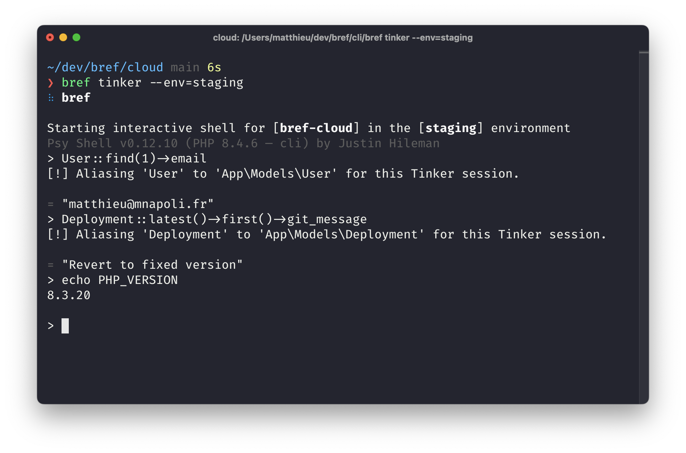

import { Tabs } from '../../../src/components/Tabs';

# Serverless Laravel - Getting started

This guide helps you run Laravel applications on AWS Lambda using Bref. These instructions are kept up to date to target the latest Laravel version.

> [!TIP]
>
> Coming from Laravel Vapor? Read the [migration guide from Laravel Vapor to Bref](./migrating-from-vapor.mdx).

## Setup

First, **follow the [Setup guide](../setup.mdx)** to create an AWS account and install the necessary tools.

Next, in an existing Laravel project, install Bref and the [Laravel-Bref package](https://github.com/brefphp/laravel-bridge).

```bash
composer require bref/bref bref/laravel-bridge --update-with-dependencies
```

Then let's create a [`serverless.yml` configuration file](../environment/serverless-yml.mdx):

```bash
php artisan vendor:publish --tag=serverless-config
```

### Configure serverless.yml

Before deploying, edit the generated `serverless.yml`:

- Set `service` to the name of your application (lowercase, without spaces).
- If you deploy with [Bref Cloud](../cloud-getting-started.mdx), uncomment the `bref` section and set `team` to the slug of your Bref Cloud team.

The generated file also sets an example `APP_KEY` so that you can deploy right away. That key is public: replace it before deploying a real application ([see below](#application-key)).

### How it works

By default, the Laravel-Bref package will automatically configure Laravel to work on AWS Lambda.

If you are curious, the package will automatically:

- replace the default `stack` log channel with `stderr`, to send logs to CloudWatch ([read more about logs](../environment/logs.mdx))
- replace the `file` session driver with the [`cookie` session driver](https://laravel.com/docs/session#configuration)
- move the storage directory to `/tmp` (because the default storage directory is read-only on Lambda)
- adjust a few more settings ([have a look at the `BrefServiceProvider` for details](https://github.com/brefphp/laravel-bridge/blob/master/src/BrefServiceProvider.php))

The generated `serverless.yml` uses the `cookie` session driver (`SESSION_DRIVER: cookie`). Cookie sessions are limited to 4 KB of data: if your application stores more in the session, use the database, DynamoDB or Redis session driver instead.

## Deployment

We do not want to deploy development dependencies (PHPUnit, Laravel Boost, etc.): they make the application larger and are not meant to run in production. Let's install Composer dependencies without them:

```bash
composer install --prefer-dist --optimize-autoloader --no-dev
```

We also do not want to deploy "dev" caches that were generated on our machine (because paths will be different on AWS Lambda). Let's clear them before deploying:

```bash
php artisan config:clear
```

Let's deploy now:

<Tabs items={['Bref Cloud', 'Serverless CLI']}>
    <Tabs.Tab>
        ```bash
        bref deploy
        ```
    </Tabs.Tab>
    <Tabs.Tab>
        ```bash
        serverless deploy
        ```
    </Tabs.Tab>
</Tabs>

When finished, the `deploy` command will show the URL of the application.

Run `composer install` to get development dependencies back locally. Remember to run `composer install --no-dev` again before every deployment, or [automate deployments in CI](/docs/deploy.md#automating-deployments).

### Deploying for production

Follow [the deployment guide](/docs/deploy.md#deploying-for-production) for more details about deploying in general.

#### Application key

The `APP_KEY` in the generated `serverless.yml` is an example key, shared by everyone who uses the file. Laravel uses it to encrypt cookies, including the session cookie: replace it before deploying a real application.

Generate a new key and store it as a [secret](../environment/variables.mdx#secrets), for example for the `prod` environment:

```bash
bref secret:create APP_KEY "$(php artisan key:generate --show)" --env=prod
```

Then reference the secret in `serverless.yml` (`my-app` is the `service` name):

```yml filename="serverless.yml"
provider:
    environment:
        APP_KEY: ${ssm:/my-app/${sls:stage}/APP_KEY}
```

> [!WARNING]
>
> `bref/laravel-bridge` installs `aws/aws-sdk-php`. This package is **very large** (100MB+) and can push your deployment over Lambda's 250MB size limit. Make sure to [remove unused AWS services](/docs/deploy.md#reducing-package-size) to reduce the deployment size. Keep `Sqs` if you use queues and `DynamoDb` if you use DynamoDB for the cache or sessions.

Specifically for Laravel, Bref will automatically cache the configuration on "cold starts". This means that you don't need to run `php artisan config:cache` before deploying.

> [!NOTE]
>
> You could improve the cold start time by pre-generating the config cache before deploying:
>
> ```bash
> php artisan config:clear && php artisan config:cache
> ```
>
> However Laravel will **hardcode** absolute paths and environment variables in the cached configuration. To deploy a valid cached configuration, you would need to run the commands above in Docker with the application mounted in `/var/task` (the same path as on AWS Lambda), with production environment variables available.
>
> For most applications we do not recommend this approach. Instead, let Bref cache the config in AWS Lambda on cold starts.

## Troubleshooting

In case your application is showing a blank page after being deployed, [have a look at the logs](../environment/logs.mdx).

## Logs

Thanks to the Bref integration, Laravel will automatically log to CloudWatch via `stderr`. You don't have to do anything.

You can learn more about logs in the [Logs guide](../environment/logs.mdx).

## Website assets

Have a look at the [Website guide](../use-cases/websites.mdx) to learn how to deploy a website with assets.

## Laravel Artisan

As you may have noticed, we define a function named "artisan" in `serverless.yml`. That function is using the [Console runtime](../runtimes/console.mdx), which lets us run Laravel Artisan on AWS Lambda.

For example, to execute an `artisan` command on Lambda, run the command below:

<Tabs items={['Bref Cloud', 'Serverless CLI']}>
    <Tabs.Tab>
        ```bash
        bref command "{artisan command and options}"
        ```

        For example:

        ```bash
        bref command "route:list --help"
        ```
    </Tabs.Tab>
    <Tabs.Tab>
        ```bash
        serverless bref:cli --args="{artisan command and options}"
        ```

        For example:

        ```bash
        serverless bref:cli --args="route:list"
        ```
    </Tabs.Tab>
</Tabs>

For more details follow [the "Console" guide](../runtimes/console.mdx).

### Laravel Tinker

If you are using [Bref Cloud](/cloud), you can start an interactive Tinker shell on AWS Lambda from your machine by running:

```bash
bref tinker
```

The usual flags work, for example to run Tinker in the production environment:

```bash
bref tinker --env=prod
```



If you are not using Bref Cloud, you can check out this community package: [sls-tinker](https://github.com/datpmwork/sls-tinker).

## Inertia

Laravel with Inertia runs without issue, like any other website. Follow the [Websites guide](../use-cases/websites.mdx) to learn how to deploy a Laravel application with assets.
