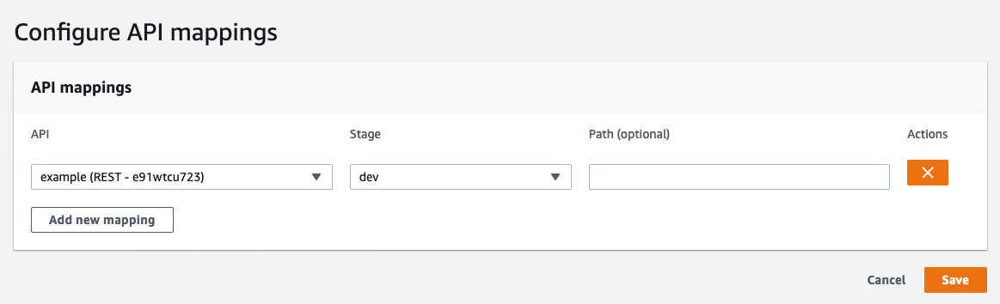

# Custom domain names

API Gateway generates random domain names for our applications:

```
https://<random>.execute-api.<region>.amazonaws.com/
```

It is possible to replace those URLs by a custom domain.

This page sets up the domain on API Gateway. For websites with assets served via CloudFront, the domain must be set up on CloudFront instead: follow the [Websites documentation](../websites.mdx#custom-domain-name).

> [!TIP]
>
> This guide assumes you already own the domain name you will want to use.

The first thing to do is register the domain in **ACM** (AWS Certificate Manager) to get an HTTPS certificate. This step is not optional.

- Open the [ACM Console](https://console.aws.amazon.com/acm/home), **switch to the region of your application**, and click "Request a certificate". The certificate must be in the same region as the API (`us-east-1` is only required for CloudFront).
- Add your domain name and click "Next"
- Choose the domain validation of your choice.
    - domain validation will require you to add CNAME entries to your DNS configuration
    - email validation will require you to click a link you will receive in an email sent to `admin@your-domain.com`

After validating the domain and the certificate we can now link the custom domain to our application via API Gateway.

- Open [API Gateway's "Custom Domain" configuration](https://console.aws.amazon.com/apigateway/main/publish/domain-names)
- **Switch to the region of your application**
- Click "Create"
- Enter your domain name, select the certificate you created above and save
- Edit the domain that was created
- Click "Configure API mappings" to add an "API mapping": select your application and the `$default` stage (or `dev` in some cases), for example:

  
- After saving the "API mappings", find the `API Gateway domain name` in the "Configurations" tab
- Create a CNAME entry in your DNS to point your domain name to this domain. A root domain (without `www.`) cannot be a CNAME: use a Route53 alias record, or a DNS provider that supports CNAME flattening.

After waiting for the DNS change to propagate (sometimes up to several hours) your website is now accessible via your custom domain.

> [!TIP]
>
> You can also take a look at the plugin [serverless-domain-manager](https://www.serverless.com/plugins/serverless-domain-manager).
> It handles the custom domain creation and optionally adds the Route53 record if asked. It is still necessary to create the ACM certificate manually.
>
> A basic implementation is proposed here : https://www.serverless.com/blog/serverless-api-gateway-domain#create-a-custom-domain-in-api-gateway
