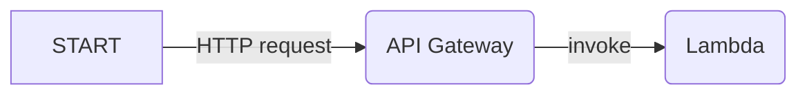

import { Cards } from 'nextra/components';
// Path relative to the copy in the `website/` folder
import { LaravelIcon } from '../../../../src/components/icons/LaravelIcon';
import { SymfonyIcon } from '../../../../src/components/icons/SymfonyIcon';

# Serverless HTTP applications

Bref deploys HTTP applications to run on AWS Lambda with [API Gateway](https://aws.amazon.com/api-gateway/):



On AWS Lambda there is no Apache or Nginx, API Gateway acts as the webserver. Our code is invoked only when there is an HTTP request, and we pay only for the request and the execution time of our code.

Bref takes care of setting up everything so that your code runs the same way as on a traditional server with Apache or Nginx.

## Usage

To deploy an HTTP application, follow the **Getting started** guide for your framework:

<Cards num={2}>
    <Cards.Card icon={<LaravelIcon />} title="Get started with Laravel" arrow="true" href="/docs/laravel/getting-started" />
    <Cards.Card icon={<SymfonyIcon />} title="Get started with Symfony" arrow="true" href="/docs/symfony/getting-started" />
    <Cards.Card title="Get started with any PHP framework" arrow="true" href="/docs/default/getting-started" />
</Cards>

### Production setup

- Websites (HTML pages with CSS, JavaScript, images…) should use CloudFront in front of API Gateway: it serves assets from S3 and hosts the custom domain. Read [Websites](/docs/use-cases/websites).
- APIs can use a custom domain directly on API Gateway. Read [Custom domains](/docs/use-cases/http/custom-domains).

## How it works

Bref sets up API Gateway with AWS Lambda and the [PHP-FPM runtime](../runtimes/fpm-runtime.mdx). This is done via the `php-xx-fpm` runtime and the `httpApi` event:

```yml filename="serverless.yml"
functions:
    web:
        handler: public/index.php
        runtime: php-84-fpm
        timeout: 28 # in seconds
        events:
            - httpApi: '*'
```

This configuration deploys an API Gateway that forwards all routes (`*` is a wildcard) to AWS Lambda.

The `timeout` is the maximum duration of a request. The default is 6 seconds. API Gateway stops waiting for a response after 30 seconds, so a higher value is useless.

On Lambda, the `php-84-fpm` runtime starts PHP-FPM and forwards all requests to it. PHP-FPM then runs the PHP code.

This is perfect for most use-cases: **PHP works like on any server** with PHP-FPM. HTTP routing based on the URL is done by the application/the framework.

The `handler` is the entrypoint of the application, usually `public/index.php` in most frameworks. That entrypoint kicks off the framework/your application, which does the routing and invokes the controllers, as usual. All the usual environment variables (like `$_GET`, `$_SERVER`, etc.) and functions (`header()`, etc.) work.

That works well with frameworks like Symfony or Laravel that have a single entrypoint (e.g. `public/index.php`).

Read the [PHP-FPM runtime documentation](../runtimes/fpm-runtime.mdx) to learn more.

### Differences with Apache and Nginx on a server

While Bref tries to make the experience as close as possible to running on a traditional server, there are some minor differences.

This section lists the differences between running on AWS Lambda and running on a traditional server with Apache or Nginx.

#### No `.htaccess` or `nginx.conf`

There is no `.htaccess` or `nginx.conf` on AWS Lambda. Handle redirects, rewrites and custom headers in the application (or in CloudFront).

#### No `fastcgi_finish_request()`

[`fastcgi_finish_request()`](https://www.php.net/manual/en/function.fastcgi-finish-request.php) is disabled by Bref, as it is not possible to run code after the response has been sent to the client. All frameworks are designed to work without it transparently, so you don't need to do anything.

#### Differences in URI query parameters

Bref rebuilds the query string before passing it to PHP-FPM. In a few edge cases, this gives different results than PHP on a server:

- Repeated keys become arrays in `$_GET`:
    - `?a=1&a=2&a=3` is parsed as `['a' => 3]` on a server with PHP-FPM, and as `['a' => [1, 2, 3]]` with Bref
    - `?a=1&a=2&a[]=3&a[]=4` is parsed as `['a' => [3, 4]]` on a server with PHP-FPM, and as `['a' => [1, 2, 3, 4]]` with Bref
- `$_SERVER['QUERY_STRING']` and `$_SERVER['REQUEST_URI']` contain the rebuilt and URL-encoded query string, not the raw query string sent by the client. For example, `?a=1&a=2` becomes `?a%5B0%5D=1&a%5B1%5D=2`.

Dots in parameter names are kept in `$_SERVER['QUERY_STRING']`, but PHP replaces them with underscores in `$_GET`, like on any server: `?a.b=c` gives `['a_b' => 'c']`.
