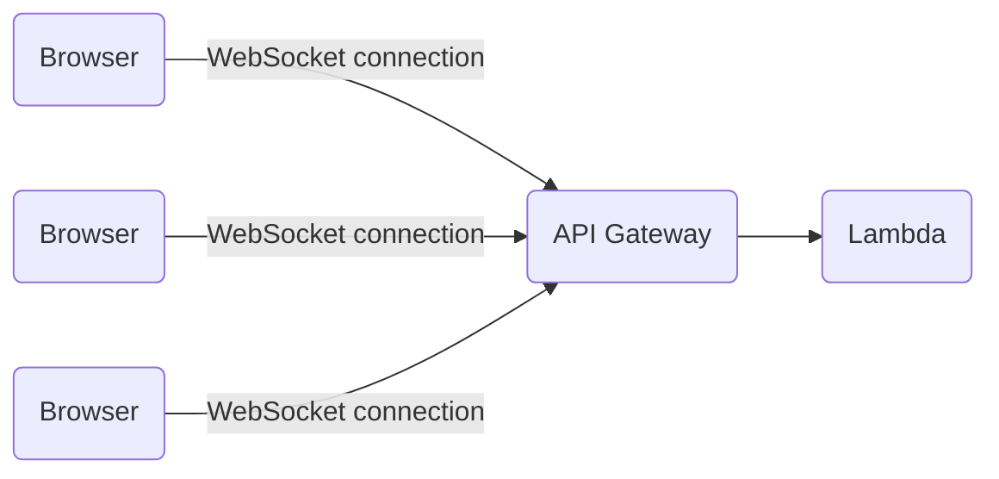

import { Tabs } from '../../../src/components/Tabs';

# WebSockets

WebSockets are great for bringing real-time updates to a web application. They allow sending events from the backend application to the frontend (JavaScript) application.

Implementing WebSockets implies maintaining a long-lived connection between the JavaScript client and the backend. As you can imagine, that is not possible with AWS Lambda. Indeed, Lambda only runs code on events: it is impossible to run code continuously.

API Gateway [can solve that problem](https://docs.aws.amazon.com/apigateway/latest/developerguide/websocket-api-develop.html): API Gateway maintains the long-lived WebSocket connections and invokes Lambda when an event happens (connection, disconnection, message).



> [!TIP]
>
> Using Laravel? Follow the [WebSockets with Laravel Broadcasting guide](/docs/laravel/websockets.mdx): Laravel Echo works out of the box, there is no handler to write.

To handle WebSocket events, extend the `WebsocketHandler` class:

```php
use Bref\Context\Context;
use Bref\Event\ApiGateway\WebsocketEvent;
use Bref\Event\ApiGateway\WebsocketHandler;
use Bref\Event\Http\HttpResponse;

class MyHandler extends WebsocketHandler
{
    public function handleWebsocket(WebsocketEvent $event, Context $context): HttpResponse
    {
        $route = $event->getRouteKey();
        $eventType = $event->getEventType();
        $body = $event->getBody();

        return new HttpResponse('ok');
    }
}
```

Then, create a Lambda function that handles WebSocket events with the handler you created:

<Tabs items={['Laravel', 'Symfony', 'PHP']}>
    <Tabs.Tab>
        ```yml filename="serverless.yml"
        functions:
            # ...
            websocket:
                handler: App\MyHandler
                runtime: php-84
                events:
                    - websocket: $connect
                    - websocket: $disconnect
                    - websocket: $default
        ```

        The `App\MyHandler` class will be instantiated by Laravel's service container.
    </Tabs.Tab>
    <Tabs.Tab>
        ```yml filename="serverless.yml"
        functions:
            # ...
            websocket:
                handler: App\MyHandler
                runtime: php-84
                events:
                    - websocket: $connect
                    - websocket: $disconnect
                    - websocket: $default
        ```

        The `App\MyHandler` class will be instantiated by Symfony's service container.
    </Tabs.Tab>
    <Tabs.Tab>
        ```yml filename="serverless.yml"
        functions:
            # ...
            websocket:
                handler: handler.php
                runtime: php-84
                events:
                    - websocket: $connect
                    - websocket: $disconnect
                    - websocket: $default
        ```

        The file `handler.php` should return the handler instance:

        ```php filename="handler.php"
        <?php

        require __DIR__ . '/vendor/autoload.php';

        return new MyHandler();
        ```
    </Tabs.Tab>
</Tabs>

The `$connect` and `$disconnect` routes are invoked when a client connects and disconnects. The `$default` route receives the messages sent by clients.

Learn more about using WebSockets in `serverless.yml` [in the Serverless Framework documentation](https://github.com/oss-serverless/osls/blob/4.x/docs/events/websocket.md).

## Sending messages to clients

To send messages to connected clients, use the [`bref/api-gateway-websocket-client`](https://github.com/brefphp/api-gateway-websocket-client) package. It calls the [API Gateway `@connections` API](https://docs.aws.amazon.com/apigateway/latest/developerguide/apigateway-how-to-call-websocket-api-connections.html), from the WebSocket function or from any other function of the application.

```bash
composer require bref/api-gateway-websocket-client
```

### Storing connection IDs

API Gateway identifies each client by a connection ID. To send messages to clients later, store their connection ID in `$connect` and delete it in `$disconnect`. For example, in a DynamoDB table with [AsyncAws](https://async-aws.com/) (`composer require async-aws/dynamo-db`):

```php
use AsyncAws\DynamoDb\DynamoDbClient;
use Bref\ApiGatewayWebsocket\SimpleWebsocketClient;
use Bref\Context\Context;
use Bref\Event\ApiGateway\WebsocketEvent;
use Bref\Event\ApiGateway\WebsocketHandler;
use Bref\Event\Http\HttpResponse;

class MyHandler extends WebsocketHandler
{
    public function handleWebsocket(WebsocketEvent $event, Context $context): HttpResponse
    {
        $dynamoDb = new DynamoDbClient();
        $table = getenv('CONNECTIONS_TABLE');
        $key = ['connectionId' => ['S' => $event->getConnectionId()]];

        switch ($event->getEventType()) {
            case 'CONNECT':
                $dynamoDb->putItem(['TableName' => $table, 'Item' => $key]);
                break;
            case 'DISCONNECT':
                $dynamoDb->deleteItem(['TableName' => $table, 'Key' => $key]);
                break;
            case 'MESSAGE':
                // Reply to the client that sent the message
                $client = SimpleWebsocketClient::create($event->getApiId(), $event->getRegion(), $event->getStage());
                $client->message($event->getConnectionId(), 'You said: ' . $event->getBody());
                break;
        }

        return new HttpResponse('');
    }
}
```

Create the table and give the functions the permissions they need in `serverless.yml`:

```yml filename="serverless.yml"
provider:
    # ...
    environment:
        CONNECTIONS_TABLE: !Ref ConnectionsTable
        WEBSOCKET_API_ID: !Ref WebsocketsApi
        WEBSOCKET_STAGE: ${sls:stage}
    iam:
        role:
            statements:
                # Send messages to connected clients
                - Effect: Allow
                  Action: execute-api:ManageConnections
                  Resource: !Sub 'arn:aws:execute-api:${AWS::Region}:${AWS::AccountId}:${WebsocketsApi}/*'
                - Effect: Allow
                  Action: [dynamodb:PutItem, dynamodb:DeleteItem, dynamodb:Scan]
                  Resource: !GetAtt ConnectionsTable.Arn

resources:
    Resources:
        ConnectionsTable:
            Type: AWS::DynamoDB::Table
            Properties:
                BillingMode: PAY_PER_REQUEST
                AttributeDefinitions:
                    - AttributeName: connectionId
                      AttributeType: S
                KeySchema:
                    - AttributeName: connectionId
                      KeyType: HASH
```

`WebsocketsApi` is the WebSocket API created by the `websocket` events: `WEBSOCKET_API_ID` and `WEBSOCKET_STAGE` let other functions send messages. The `execute-api:ManageConnections` permission allows sending messages to clients. The table is deleted with the environment.

### Sending a message

From any function, create the client with the API ID, region and stage, then send a message to a connection ID. This example sends a message to every connected client:

```php
use AsyncAws\Core\Exception\Http\ClientException;
use AsyncAws\DynamoDb\DynamoDbClient;
use Bref\ApiGatewayWebsocket\SimpleWebsocketClient;

$dynamoDb = new DynamoDbClient();
$table = getenv('CONNECTIONS_TABLE');
$client = SimpleWebsocketClient::create(getenv('WEBSOCKET_API_ID'), getenv('AWS_REGION'), getenv('WEBSOCKET_STAGE'));

foreach ($dynamoDb->scan(['TableName' => $table])->getItems() as $item) {
    $connectionId = $item['connectionId']->getS();
    try {
        $client->message($connectionId, json_encode(['type' => 'order-shipped', 'id' => 123]));
    } catch (ClientException $e) {
        if ($e->getCode() !== 410) {
            throw $e;
        }
        // 410 Gone: the client is no longer connected
        $dynamoDb->deleteItem(['TableName' => $table, 'Key' => ['connectionId' => ['S' => $connectionId]]]);
    }
}
```

`$disconnect` is [not guaranteed to be invoked](https://docs.aws.amazon.com/apigateway/latest/developerguide/apigateway-websocket-api-route-keys-connect-disconnect.html#apigateway-websocket-api-routes-about-disconnect), so the table can contain connection IDs of clients that are gone: `message()` then throws a `ClientException` with the code 410, and the connection ID should be deleted.

`SimpleWebsocketClient` also has `disconnect($connectionId)` to close a connection, and `status($connectionId)` to get the IP address, user agent, and connection date of a client.

### Connecting clients

Clients connect to `wss://<api-id>.execute-api.<region>.amazonaws.com/<stage>`. This URL is displayed at the end of `bref deploy` and `serverless deploy`. With Bref Cloud, the stage is the name of the environment.

```js
const socket = new WebSocket('wss://abcdef1234.execute-api.eu-west-3.amazonaws.com/dev');

socket.onopen = () => socket.send('Hello');
socket.onmessage = (event) => console.log(event.data);
```

Messages sent with `socket.send()` invoke the `$default` route.

API Gateway closes connections after 2 hours, and after 10 minutes without any message: clients must reconnect. Messages are limited to 128 KB. See all the [WebSocket API quotas](https://docs.aws.amazon.com/apigateway/latest/developerguide/apigateway-execution-service-websocket-limits-table.html).
