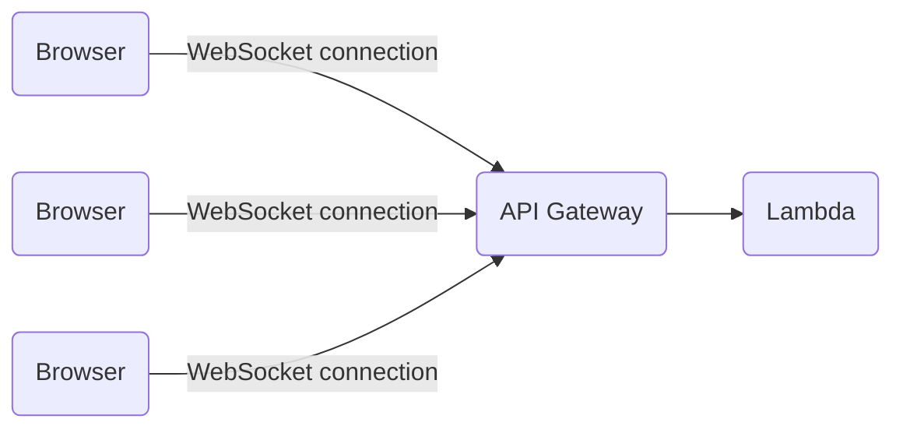

import { Tabs } from '../../../src/components/Tabs';

# WebSockets

WebSockets are great for bringing real-time updates to a web application. They allow sending events from the backend application to the frontend (JavaScript) application.

Implementing WebSockets implies maintaining a long-lived connection between the JavaScript client and the backend. As you can imagine, that is not possible with AWS Lambda. Indeed, Lambda only runs code on events: it is impossible to run code continuously.

API Gateway [can solve that problem](https://docs.aws.amazon.com/apigateway/latest/developerguide/websocket-api-develop.html): API Gateway maintains the long-lived WebSocket connections and invokes Lambda when an event happens (connection, disconnection, message).



> [!TIP]
>
> Using Laravel? Follow the [WebSockets with Laravel Broadcasting guide](/docs/laravel/websockets.mdx): Laravel Echo works out of the box, there is no handler to write.

To handle WebSocket events, extend the `WebsocketHandler` class:

```php
use Bref\Context\Context;
use Bref\Event\ApiGateway\WebsocketEvent;
use Bref\Event\ApiGateway\WebsocketHandler;
use Bref\Event\Http\HttpResponse;

class MyHandler extends WebsocketHandler
{
    public function handleWebsocket(WebsocketEvent $event, Context $context): HttpResponse
    {
        $route = $event->getRouteKey();
        $eventType = $event->getEventType();
        $body = $event->getBody();

        return new HttpResponse('ok');
    }
}
```

Then, create a Lambda function that handles WebSocket events with the handler you created:

<Tabs items={['Laravel', 'Symfony', 'PHP']}>
    <Tabs.Tab>
        ```yml filename="serverless.yml"
        functions:
            # ...
            websocket:
                handler: App\MyHandler
                runtime: php-84
                events:
                    - websocket: $connect
                    - websocket: $disconnect
                    - websocket: $default
        ```

        The `App\MyHandler` class will be instantiated by Laravel's service container.
    </Tabs.Tab>
    <Tabs.Tab>
        ```yml filename="serverless.yml"
        functions:
            # ...
            websocket:
                handler: App\MyHandler
                runtime: php-84
                events:
                    - websocket: $connect
                    - websocket: $disconnect
                    - websocket: $default
        ```

        The `App\MyHandler` class will be instantiated by Symfony's service container.
    </Tabs.Tab>
    <Tabs.Tab>
        ```yml filename="serverless.yml"
        functions:
            # ...
            websocket:
                handler: handler.php
                runtime: php-84
                events:
                    - websocket: $connect
                    - websocket: $disconnect
                    - websocket: $default
        ```

        The file `handler.php` should return the handler instance:

        ```php filename="handler.php"
        <?php

        require __DIR__ . '/vendor/autoload.php';

        return new MyHandler();
        ```
    </Tabs.Tab>
</Tabs>

The `$connect` and `$disconnect` routes are invoked when a client connects and disconnects. The `$default` route receives the messages sent by clients.

To send a message to a connected client, you can use the [bref/api-gateway-websocket-client library](https://github.com/brefphp/api-gateway-websocket-client) to make an HTTP request to the endpoint provided by AWS.

Learn more about using WebSockets in `serverless.yml` [in the Serverless Framework documentation](https://github.com/oss-serverless/osls/blob/4.x/docs/events/websocket.md).

> [!TIP]
>
> A complete WebSocket example is available in [Serverless Visually Explained](https://serverless-visually-explained.com/).
