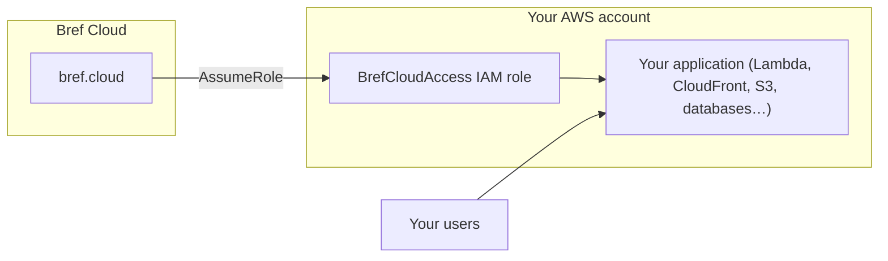
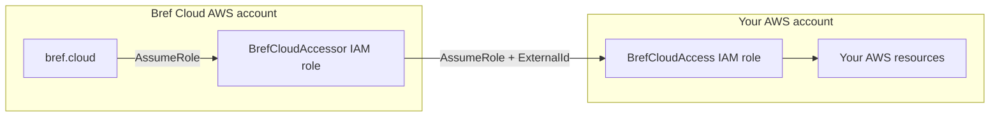

# Bref Cloud security

Bref Cloud deploys your application to **your own AWS account**. Your code, your data and your users' data stay there. Bref Cloud manages the deployments through an IAM role that you create, review and can delete at any time.

## Your application runs in your AWS account

- **HTTP traffic** goes straight to your AWS account (CloudFront, API Gateway, Lambda). It never goes through Bref Cloud.
- **Code**: `bref deploy` packages your application and uploads it to a deployment bucket in your AWS account.
- **Data**: databases, files, queues, caches and logs are AWS resources in your account.
- **Secrets** are stored in AWS SSM Parameter Store, in your account.

If Bref Cloud is down, your application keeps running: only deployments and the dashboard are unavailable.

## What Bref Cloud stores

Bref Cloud stores what it needs to manage your applications:

- your Bref Cloud account: users, teams, roles and the audit log,
- the connected AWS accounts: account ID, IAM role ARN and `ExternalId` (encrypted),
- the list of applications, environments and the AWS resources they use,
- the history of deployments: status, logs, Git commit and author,
- the output of the commands you run from the dashboard (for example `php artisan migrate`).

Logs, metrics and traces are read from your AWS account when you open them in the dashboard, and only cached for a short time. Secret values are read from SSM Parameter Store when you open them, and are not stored.

Bref Cloud does not store AWS access keys (see below).

## Your DPA is with AWS

Bref Cloud does not host your users' personal data. It is stored in your AWS account, under your agreement with AWS. For the GDPR, that means your data processing agreement (DPA) is with AWS: the [AWS GDPR DPA](https://aws.amazon.com/compliance/gdpr-center/) is part of the AWS Service Terms and applies to every AWS account automatically.

Bref Cloud is operated by Null SAS, a company registered in France.

## How Bref Cloud accesses your AWS account

Bref Cloud never uses AWS access keys. To connect an AWS account, you create the `bref-cloud-connect` CloudFormation stack in it. The stack creates a `BrefCloudAccess` IAM role that only Bref Cloud can assume:

- **Temporary credentials**: Bref Cloud assumes the role for each operation and gets short-lived credentials. Nothing to leak or rotate.
- **A unique `ExternalId` per team**: only your Bref Cloud team can assume the role in your account. The `ExternalId` is stored encrypted, with the key kept separately from the database.
- **An intermediate role**: the Bref Cloud application goes through a `BrefCloudAccessor` role that Bref's own AWS administrators cannot use.

The role has the permissions needed to deploy applications with CloudFormation, which includes creating IAM roles, databases or queues. You can review the exact permissions in the stack template before creating it, and in the IAM role afterwards. You can also restrict them further.

Read [Secure access to your AWS accounts](/docs/cloud-security) for the details.

## Revoke access at any time

Delete the `bref-cloud-connect` CloudFormation stack (in the `us-east-1` region): Bref Cloud's access to your AWS account is revoked immediately and permanently.

Your applications keep running: they are standard CloudFormation stacks in your account, and you can keep managing them without Bref Cloud.

## Access control in your team

- Team members get read-only, write or admin access to Bref Cloud. They do not need any AWS access.
- Only members with write or admin access can deploy.
- Two-factor authentication is available for every user.
- The audit log records who did what in the team.
- AWS accounts are connected separately: use one AWS account per environment (for example production and development) to isolate them.

## Self-hosted Bref Cloud

Self-hosting means running Bref Cloud in your own AWS account: no third party has access to your AWS accounts. It is available with the Enterprise plan, [get in touch](https://calendly.com/bref-enterprise/intro).

## Reporting a vulnerability

Send an email to [security@bref.sh](mailto:security@bref.sh). Please do not disclose security issues publicly until a fix has been released.
